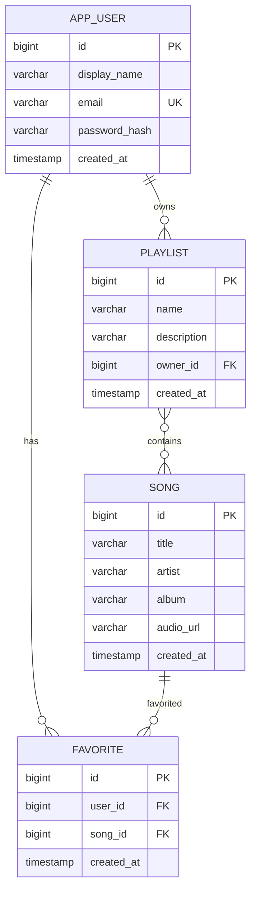

# Entity relationship diagramı

## JPA ilişkileri

- `AppUser` -> `Playlist`: çift yönlü `@OneToMany` / `@ManyToOne`; `Playlist.owner` sahip taraftır.
- `AppUser` -> `Favorite`: çift yönlü `@OneToMany` / `@ManyToOne`; `Favorite.user` sahip taraftır.
- `Song` -> `Favorite`: çift yönlü `@OneToMany` / `@ManyToOne`; `Favorite.song` sahip taraftır.
- `Playlist` <-> `Song`: çift yönlü `@ManyToMany`; `Playlist.songs` sahip taraftır ve `playlist_songs` bağlantı tablosunu yönetir.

`app_users.email` benzersizdir. `favorites` tablosunda `(user_id, song_id)` ikilisi benzersizdir; böylece aynı kullanıcı aynı şarkıyı birden fazla kez favorileyemez.

Şarkı silme işlemi transaction içinde önce playlist bağlantılarını ve favori kayıtlarını kaldırır, ardından şarkıyı siler. Böylece foreign-key kısıtlarından kaynaklanabilecek silme hataları önlenir.
